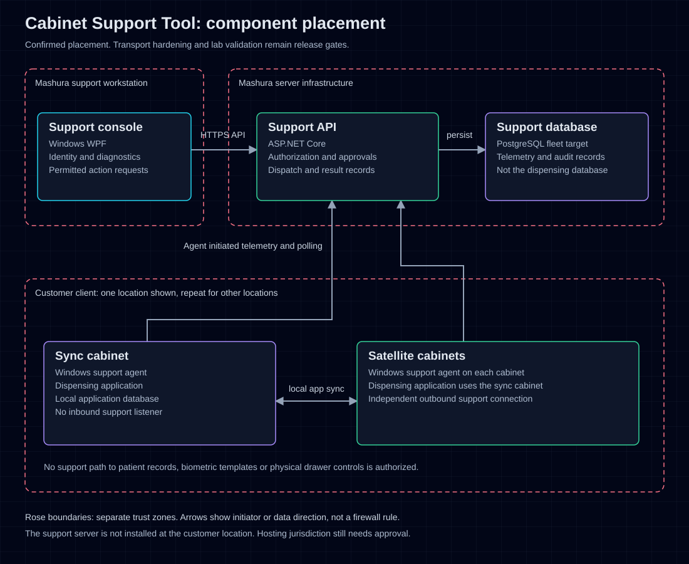

# Cabinet Support Tool

An internal Windows support tool for Mashura cabinet PCs. Support staff use a desktop console to inspect a machine and request approved IT operations without taking over its desktop.

Production release is blocked while the audited defects are repaired and Windows lab testing is completed. See the [release gates](docs/readiness.md). Passing automated tests does not establish that a cabinet is safe to deploy.

## Where it runs

Mashura hosts the support API and its support database. The console runs on a support workstation. Each customer cabinet runs a lightweight Windows agent that initiates outbound connections to the API.

Clients can have multiple locations and several cabinets at each location. Typically one cabinet holds the location's application database and acts as the sync cabinet. Other cabinets communicate with it locally. The Mashura support server does not replace or read that application database.



## Scope

The product supports the development of Windows diagnostics and controlled operations: process and service management, network inspection and configuration, Windows updates, event logs, storage health and display recovery. Individual workflows must pass their release gates before being enabled in production.

Physical cabinet sensors, drawer opening, lock release and cubie opening remain excluded. The Windows support scope does not permit arbitrary shell commands, scripts or access to patient records.

## Projects

1. `CabinetPlatform.Contracts` defines the messages shared across processes.
2. `CabinetPlatform.Agent` collects machine information and performs named Windows actions through typed gateways.
3. `CabinetPlatform.Server` owns support authorization, device registration, topology, approvals and result storage.
4. `CabinetPlatform.Console.Core` contains the API client and ViewModels without a WPF dependency.
5. `CabinetPlatform.Console` contains the actual Windows desktop interface. Build it explicitly as well as building the solution.

## Build and test

Use an official .NET 8 SDK. WPF runtime testing requires Windows. Cross compilation on Linux does not verify the desktop interface or native Windows operations.

```text
dotnet build CabinetPlatform.sln --configuration Release
dotnet build src/CabinetPlatform.Console/CabinetPlatform.Console.csproj --configuration Release
dotnet test CabinetPlatform.sln --configuration Release
```

The explicit console build is intentional. The initial audit found that the solution omitted the WPF project while its tests still passed. Release checks must enumerate all deliverable applications.

Do not run the agent, network changes, updates or process controls on a production cabinet while developing. Use an authorized Windows lab machine with an independent recovery console and snapshots. Keep all credentials outside source and test evidence.

## Documentation

1. [Product requirements](docs/requirements.md)
2. [Architecture and data flow](docs/architecture.md)
3. [Release gates](docs/readiness.md)
4. [Display recovery requirement](docs/display.md)
5. [Build notes](docs/building.md)
6. [Agent behavior](docs/agent.md) and [installation](docs/agent-install.md)
7. [Support console](docs/console.md)
8. [Shared contracts](docs/contracts.md)
9. [Security invariants](docs/security-invariants.md)
10. [Location topology](docs/topology.md)
11. [Telemetry and retention](docs/check-in-tiers.md)
12. [Data residency](docs/data-residency.md) and [time zones](docs/time-zones.md)

The component documents are being reconciled with the audit. Treat an unverified safety claim in those documents as a requirement to test, not deployment approval. The release gates take precedence over historical claims of readiness.
