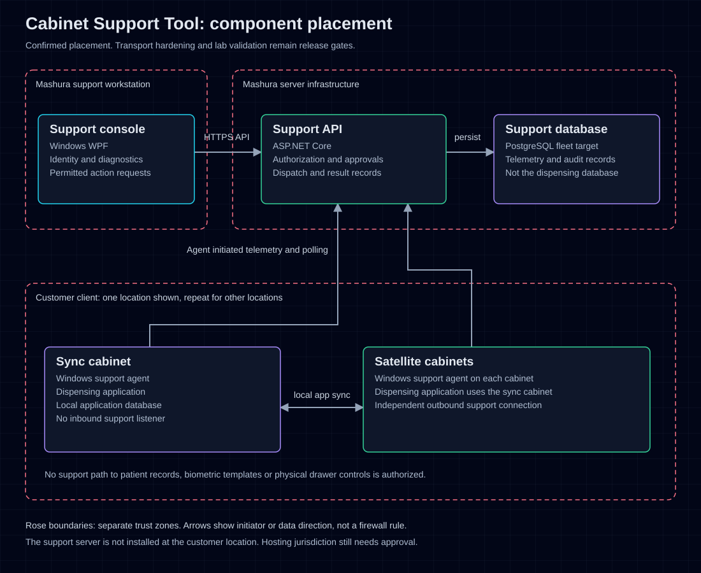
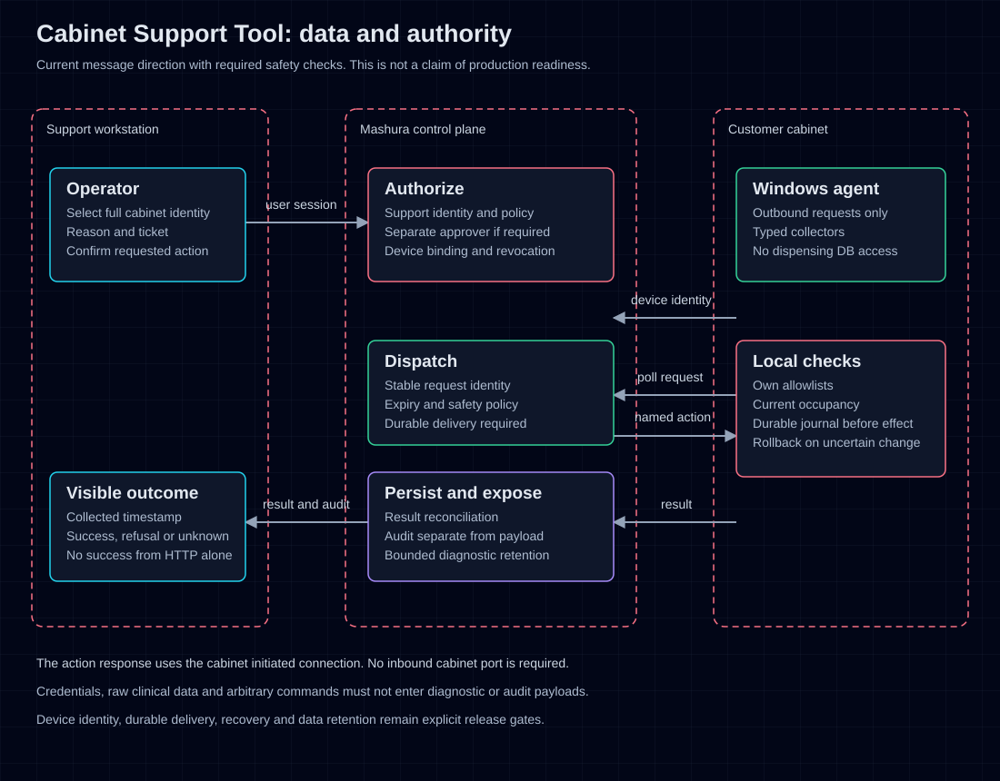

# Architecture

The support server runs on Mashura infrastructure. Customer sites keep their own cabinets and local application databases. The diagram shows this placement, not a claim that the production deployment has passed review.

## Process boundaries

The agent is a Windows Worker Service. It collects machine information and executes a fixed action catalog through typed Windows gateways. It initiates registration, telemetry and action polling requests. Commands return on those outbound requests; the server does not connect to a cabinet listener.

The server is an ASP.NET Core API. It owns support authorization, cabinet registration, site topology, approval records and dispatch. It stores support telemetry and audit evidence separately from the dispensing application's database. PostgreSQL is the documented fleet storage target. SQLite remains useful for local development and tests.

The console is a Windows WPF application. Its API client and ViewModels live in Console.Core so most presentation behavior can be tested without WPF. The WPF project must still compile and undergo real UI testing. A test that calls a ViewModel method directly does not prove that an operator can reach it.

Contracts define the messages crossing these boundaries. A contract needs explicit semantics for absent data, timestamps, action identity, expiry and uncertainty. Adding a property alone does not implement a workflow.

## Data and authority

A support user is not a cabinet identity. The server must authenticate each separately and bind every device credential to one cabinet. A machine identifier in a header is not proof of ownership.

The console can request a permitted operation but cannot waive a server or cabinet safety rule. The agent must apply its own local allowlists and safety checks immediately before execution. It must refuse unsafe work even if a server accepted the request earlier.

The existing product policy lets support users view cabinets across clients. That is an intentional internal desk policy, not isolation between customer users. Do not expose these accounts to customers or outside support teams without a separate authorization design and approval.

The local sync relationship belongs to the dispensing system. Cabinet network probes can diagnose that relationship; they do not authorize reading or modifying the local dispensing database.

## Reliability work required

A durable command protocol needs stable action identifiers, acknowledged receipt, an execution journal and a result outbox. Interrupted work must be represented as an unknown outcome until evidence resolves it. A timeout does not prove that a mutation did not occur.

The initial audit found gaps in these paths and in network recovery. See [release gates](readiness.md). These paragraphs describe the required behavior and must not be used as proof that every path is implemented.
